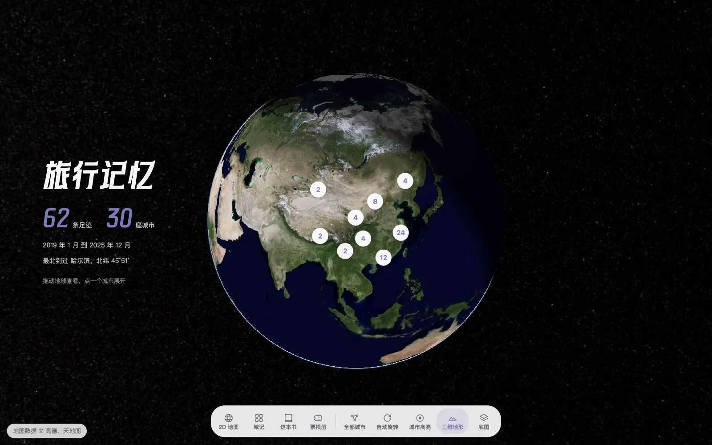
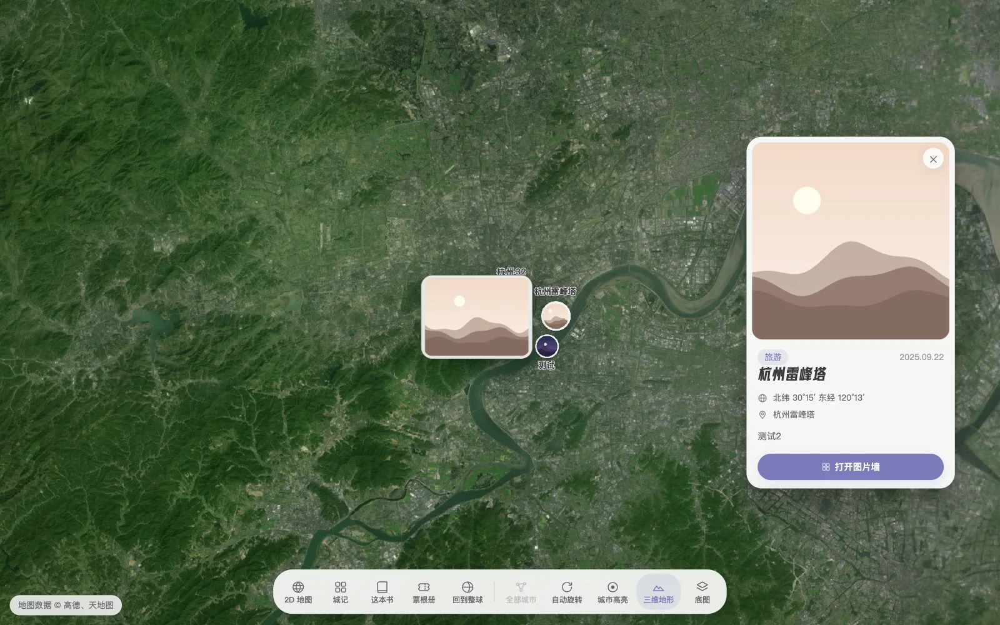
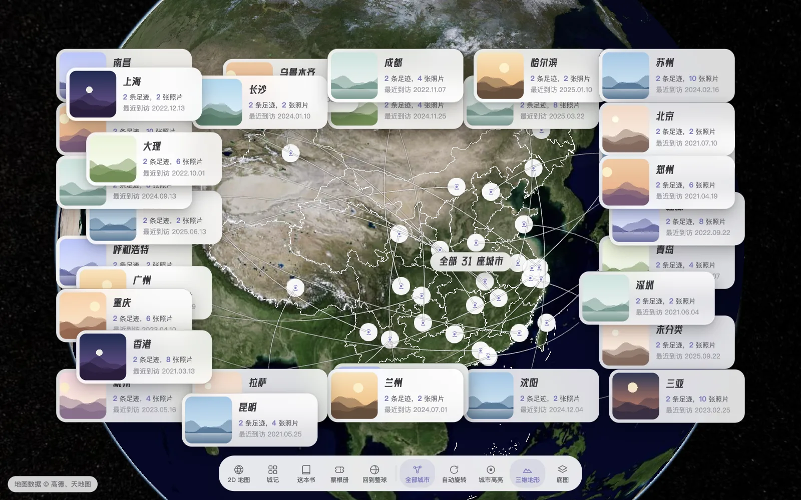
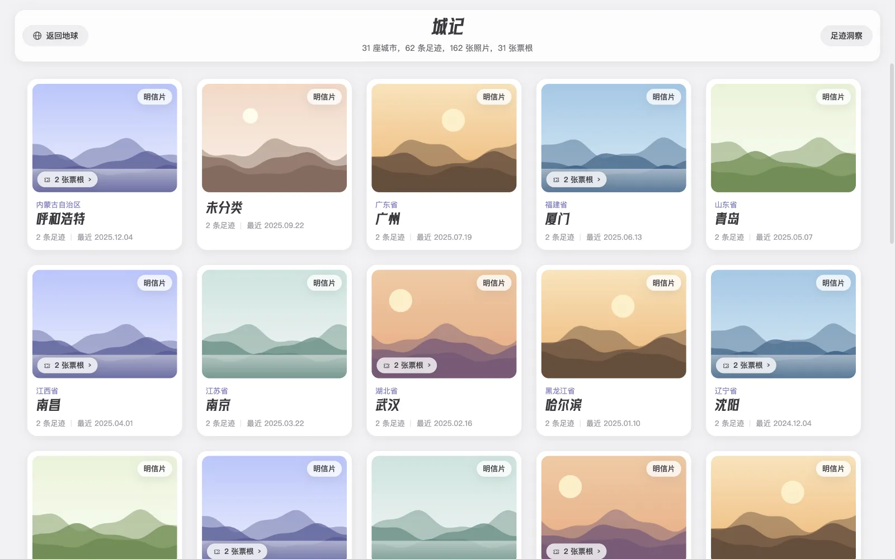
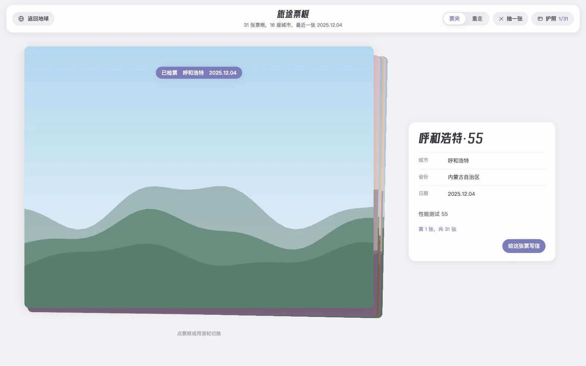
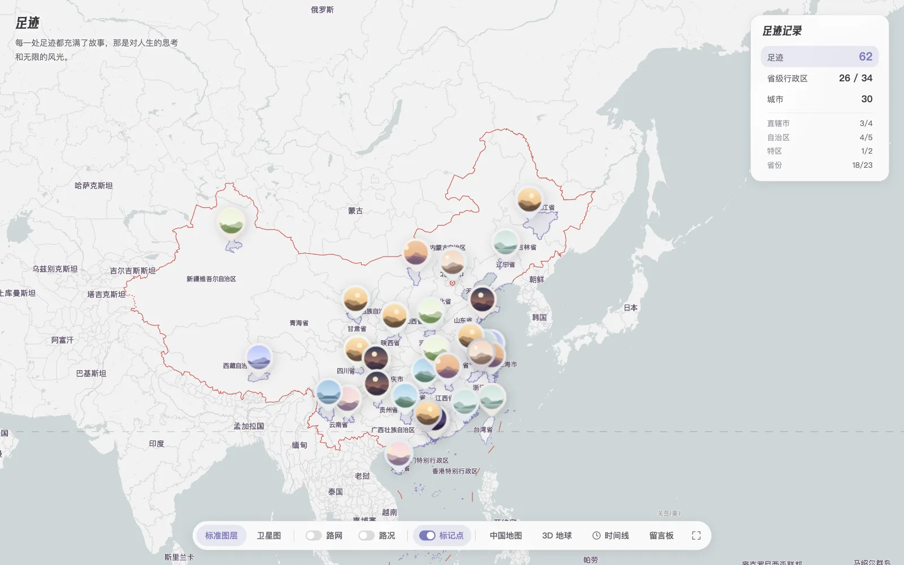
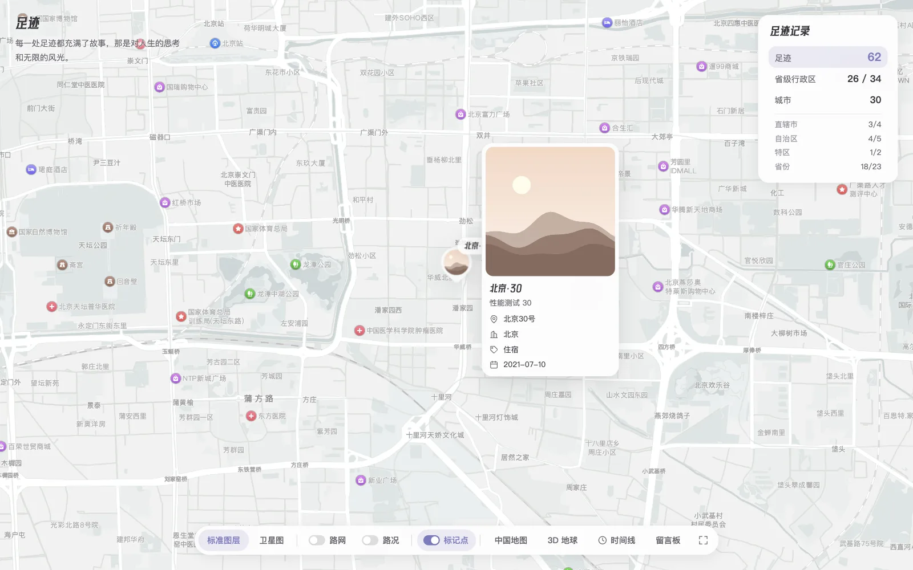

# Halo-Plugin-Footprint

> Halo 足迹插件：把去过的地方放到一颗 3D 地球上，也能切回 2D 高德地图，按时间回看。

## 演示与交流

- **演示站**：[xhhao.com/footprints](https://www.xhhao.com/footprints)（Handsome）、[yunduan019.com/footprints](https://www.yunduan019.com/footprints)（云端）
- **文档**：[docs.lik.cc](https://docs.lik.cc/)
- **源码**：[GitHub](https://github.com/acanyo/halo-plugin-footprint)
- **QQ 交流群**：[](https://www.xhhao.com/upload/iShot_2025-03-03_16.03.00.png)



每条足迹是一个地点、一组照片、一张可选的票根和一篇可选的关联文章。后台录入，前台 `/footprints` 展示：
默认是 Cesium 3D 地球，底部导航可以切到 2D 高德地图、按城市翻相册、看票根、翻「世界这本书」。

## 截图

| | |
| --- | --- |
|  |  |
| **足迹卡与照片环**：放大到城市后点一个足迹点，弹出足迹卡，照片环绕着标记展开 | **全部城市**：每座去过的城市一张小卡片，从城市圆点拉一条引线过去，可拖动 |
|  |  |
| **城记**：按城市排的卡片墙，点进去是这座城的相册；顶栏有「去年今天」和「足迹洞察」 | **票根册**：票夹叠放或横向长串两种切换方式 |
|  |  |
| **世界这本书**：每个省一本书，翻开是这个省的照片 | **2D 地图**：高德地图，去过的城市按主题色描边填色，带时间线和统计 |



2D 地图上点任意足迹，地图飞过去并弹出信息卡：封面、地址、城市、类型、日期，有关联文章时带「查看文章」。

## 功能

**3D 地球**

- 整球视野按城市聚合：圆点上的数字是这座城的足迹数；屏幕上挨得太近的几座城会合成一个点，点它飞近后再分开。
- 放大到城市展开成单个足迹，点足迹弹出足迹卡和照片环；点城市打开城市卡和相册。
- 点省份（放大到能看见中国轮廓时）：这个省每座去过的城市各出一张卡片，带引线；「全部城市」一次铺开所有城市。
- 常驻地名标注，同屏多个名字做屏幕空间避让，不叠字。
- 底图：高德矢量 / 卫星（默认卫星无字），配置天地图 Key 后可用天地图影像 / 矢量与三维地形。
- 自动旋转、城市高亮、三维地形开关都在底部导航坞里；窄屏收进「工具」。

**城记、票根与书**

- 城记：城市卡片墙 → 城市相册 → 图片灯箱；可选「去年今天」「足迹洞察」「旅行明信片」。
- 票根册：票夹 / 横向长串两种样式；可选「重走一遍」放映、「时间有色」、「命运抽票」、「未寄出的明信片」、「护照集章」。
- 世界这本书：three.js 书架，每个省一本，屋子的配色随书变。
- 留言板：3D 底部坞和 2D 控制栏都有「留言板」，点开是整页一个 Halo 评论区。需要安装评论组件插件并在站点设置里开启评论，否则按钮不显示。

**2D 地图**

- 高德地图，11 种内置样式，4 种标记点样式、4 种时间线悬停高亮。
- 每条足迹可以存自己的缩放级别，`>= 18` 时还能存俯仰角和旋转角。
- 时间线抽屉：按时间倒序；悬停卡片时地图移过去，从卡片到标记画一条抛物线。
- 已去过的城市按主题色描边、填色；标准 / 卫星、路网、路况、标记显隐、回到中国全图、全屏。

**后台**

- 足迹增删改查、关键字 / 类型筛选、批量删除、统计；地址自动解析经纬度，回填省市与 adcode。
- 主题色用 Halo 的取色组件选，前台三个页面的强调色都跟着它。
- 带效果图的样式选项（标记点样式、悬停高亮、地名标注）。
- 仪表盘足迹统计小组件。
- Finder API，主题可以自己渲染足迹。

## 环境要求

- Halo `>= 2.27.0`
- 高德 JS Key（加载地图）和高德 Web 服务 Key（服务端地理编码、逆地理编码、POI 搜索）
- 天地图 Key（可选）：3D 地球的天地图底图与三维地形，不填只用高德底图

## 安装

1. 从 [GitHub Releases](https://github.com/acanyo/halo-plugin-footprint/releases) 下载插件 JAR，或在 Halo 应用市场搜索「足迹」。
2. Halo 控制台 →「插件」→「安装」，上传 JAR 并启用。
3. 在插件设置里选择高德 Key（见下一节），保存。

## 快速使用

1. 在 Halo 控制台「设置 → 密钥」里创建两个 Secret，各带一个 `key` 字段，分别放高德 JS Key 和 Web 服务 Key；
   回到插件设置的「基本设置」里选中它们。
2. 控制台「内容 → 足迹」新建一条：
   - 名称、描述、详细地址，地址会自动解析出经纬度；
   - 封面、图片墙图片（可拖动排序）、票根图片；
   - 类型、关联文章或自定义链接、关联足迹；
   - 缩放级别；`>= 18` 时可以再设 3D 俯仰角和旋转角。
3. 打开 `/footprints`。

## 插件设置

### 基本设置

| 配置项 | 默认值 | 说明 |
| --- | --- | --- |
| 页面标题 | `我的足迹` | 浏览器标签页标题 |
| 左下角标题 | `足迹` | 2D 地图左上角的标题 |
| 足迹描述 | `每一处足迹都充满了故事…` | 2D 地图标题下的一句话 |
| 主题色 | `#7c7bc0` | 取色组件。前台的强调色：按钮选中、城市圆点、去过的城市、省份高亮、明信片、票根都用它 |
| 启用悬停缩放 | 开 | 悬停时间线卡片时，先缩放到对应位置再画抛物线 |
| 高亮已去过城市 | 开 | 2D 地图上用主题色描边、填色去过的城市 |
| 高德 Js Key / Web Key | 无 | 选择含 `key` 字段的 Secret |
| 地图样式 | `标准` | 高德内置样式 |
| 标记点样式 | 照片徽章 | 水滴 / 简约圆形 / 卡片 / 照片徽章，带效果图 |
| 悬停高亮方案 | 边框高亮环 | 缩放光晕 / 脉冲光环 / 弹跳 / 边框高亮环，带效果图 |

### 3D 地球

| 配置项 | 默认值 | 说明 |
| --- | --- | --- |
| 3D 地球标题 | `旅行记忆` | 首页左侧的大标题 |
| 3D 地球描述 | 空 | 标题下的一句话，可留空 |
| 地球地名标注 | 城市名 + 足迹名 | 关闭（仅悬停显示）/ 只显示城市名 / 城市名 + 足迹名，带效果图。用无字底图时建议开着 |

### 天地图

| 配置项 | 默认值 | 说明 |
| --- | --- | --- |
| 天地图 Key | 无 | 选择含 `key` 字段的 Secret，在 [天地图开放平台](https://lbs.tianditu.gov.cn) 申请浏览器端 Key |
| 默认启用三维地形 | 关 | 进入 3D 地球时是否默认开地形，导航里仍可手动切换 |

### 票根页

| 配置项 | 默认值 | 说明 |
| --- | --- | --- |
| 切换样式 | 票夹切换 | 票夹叠放 / 横向长串 |
| 重走一遍 | 关 | 按日期从第一张票开始，镜头在城市间飞行逐张回放 |
| 时间有色 | 关 | 页面氛围色跟着票根月份变 |
| 命运抽票 | 关 | 洗牌翻开一张票根，并给出一个还没去过的城市 |
| 未寄出的明信片 | 关 | 每张票根可以生成一张明信片下载 |
| 护照集章 | 关 | 浏览票根时盖章（存在本机），有护照进度页 |

### 城市卡片墙

| 配置项 | 默认值 | 说明 |
| --- | --- | --- |
| 移动端每排城市数 | `2` | 1–3 |
| 去年今天 | 开 | 历史同月同日有足迹时，顶栏出现入口 |
| 足迹洞察 | 开 | 顶栏「足迹洞察」：旅行总结与统计 |
| PC 悬停轮播 | 开 | 悬停城市卡时封面在最多 3 张照片间轮播 |
| 旅行明信片 | 开 | 城市卡上的「明信片」按钮 |

### 高级设置

| 配置项 | 默认值 | 说明 |
| --- | --- | --- |
| 足迹类型 | `旅游、美食、购物、住宿、交通、其他` | 后台新建和筛选足迹时的类型列表 |

### 图片处理

图床能为同一张原图出不同尺寸的缩略图时，可以按用途配置 URL 规则。**全部留空时直接用足迹里保存的图片 URL**，大多数图床和 Halo 本地附件都不用配。

| 用途 | 三项 | 说明 |
| --- | --- | --- |
| 标记点图片 | 要替换的片段 / 替换为 / 追加后缀 | 2D 标记点小图 |
| 时间线 / 详情图片 | 同上 | 2D 时间线与信息卡 |
| 城市卡片墙图片 | 同上 | 3D 城市卡片墙封面与轮播；三项都留空时沿用标记点的替换规则 |

阿里云 OSS 示例：标记点 `!w100 → !A100`，追加 `/fw/200`；时间线 `!w100 → !A100`，追加 `/fw/500`。

## 从旧版本升级

- **2.0.0**：前台换成「柔光玻璃」风格，导航移到底部导航坞。
  - 2D 地图的图片墙去掉了，点任何足迹都弹同一张信息卡；后台的「图片墙样式」「图片墙单页展示数量」两项一并删除。
  - 「hsl颜色值」换成取色组件「主题色」，旧值升级时自动换算。以前它只管 2D 去过的城市，现在全站跟着它变：存过别的颜色的站点，升级后整个前台会换成那个颜色。想要默认的淡紫，选回 `#7c7bc0` 即可。
  - 要求 Halo `>= 2.27.0`。
- **2.9.1**：高德 Key 改为选择 Secret，不再填明文；旧的明文配置不会自动迁移，需要重新选择。

## 后台管理

控制台菜单在「内容」分组下的「足迹」（`/footprint`）。角色模板：

- `足迹查看`：查看足迹列表和统计。
- `足迹管理`：新建、编辑、删除足迹，调用地理编码等接口。

## 主题适配与 Finder API

插件为 `/footprints` 提供默认模板 `src/main/resources/templates/footprint.html`，模板里可以用：

- `settings`：插件设置；
- `footprints`：按创建时间倒序的全部足迹。

另外注册了 Finder `footprintFinder`，主题可以自己渲染足迹：

| 方法 | 返回值 | 说明 |
| --- | --- | --- |
| `listAll()` | `Flux<FootprintVo>` | 全部足迹 |
| `list(page, size)` | `Mono<ListResult<FootprintVo>>` | 分页，页码从 `1` 开始 |
| `getByName(name)` | `Mono<FootprintVo>` | 按 `metadata.name` 取一条 |
| `listByName(page, size, name)` | `Mono<ListResult<FootprintVo>>` | 按 `spec.name` 分页 |

```html
<div th:each="footprint : ${footprintFinder.listAll()}">
  <span th:text="${footprint.spec.name}"></span>
  <p th:text="${footprint.spec.description}"></p>
</div>

<th:block th:with="page = ${footprintFinder.list(1, 10)}">
  <a th:each="footprint : ${page.items}" th:href="${footprint.spec.article}"
     target="_blank" th:text="${footprint.spec.name}"></a>
</th:block>
```

静态资源路径前缀是 `/plugins/footprint/assets/static/**`。

## 数据模型

自定义模型 `Footprint`，`apiVersion: footprint.lik.cc/v1alpha1`。

| 字段 | 类型 | 说明 |
| --- | --- | --- |
| `spec.name` | string | 名称 |
| `spec.description` | string | 描述 |
| `spec.longitude` / `spec.latitude` | number | 经纬度 |
| `spec.address` | string | 详细地址 |
| `spec.zoomLevel` | string | 2D 缩放级别 |
| `spec.pitchAngle` / `spec.rotationAngle` | string | 2D 俯仰角（`0–83`）/ 旋转角（`-360–360`），缩放级别 `>= 18` 时生效 |
| `spec.footprintType` | string | 类型 |
| `spec.image` | string | 封面 |
| `spec.galleryImages` | array | 图片墙图片 `{url, order}`，也兼容旧版字符串数组；3D 照片环与相册用它，2D 信息卡没有封面时取第一张 |
| `spec.ticketImage` | string | 票根图片 |
| `spec.article` | string | 关联文章（站内路径）或自定义链接 |
| `spec.metadataNames` | array | 关联足迹的 `metadata.name` |
| `spec.createTime` | instant | 到访时间 |
| `spec.province` / `spec.city` | string | 省 / 市 |
| `spec.provinceAdcode` / `spec.cityAdcode` | string | 省 / 市行政区编码 |

## HTTP API

模型的标准 CRUD 由 Halo 提供：`/apis/footprint.lik.cc/v1alpha1/footprints[/{name}]`。

插件自己的接口：

| 方法 | 路径 | 说明 |
| --- | --- | --- |
| `GET` | `/apis/api.footprint.lik.cc/v1alpha1/footprints` | 分页查询，支持 `page`、`size`、`sort`、`keyword`、`footprintType` |
| `GET` | `/apis/api.footprint.lik.cc/v1alpha1/footprints/stats` | 统计：足迹数、省份、城市 |
| `GET` | `/apis/api.footprint.lik.cc/v1alpha1/footprints/location/{address}` | 地址转经纬度，返回 `经度,纬度` |
| `POST` | `/apis/api.footprint.lik.cc/v1alpha1/footprints/{name}/geocode` | 对一条足迹做逆地理编码，回填省市与 adcode |
| `GET` | `/apis/api.footprint.lik.cc/v1alpha1/footprints/-/reverse-geocode` | 任意经纬度逆地理编码（控制台地图选点用） |
| `GET` | `/apis/api.footprint.lik.cc/v1alpha1/footprints/-/map-config` | 控制台地图选点需要的浏览器端配置 |
| `GET` | `/footprints/image-proxy?url=` | 同源图片代理 |

图片代理用于把跨域的票根、照片画进 canvas（明信片、书架贴图），否则浏览器会拒绝导出。
只代理本站足迹里出现过的图片域名，拒绝内网地址、非 http(s) 与非图片响应，单张上限 10MB。

## 开发

```text
src/main/java                Halo 插件后端
src/main/frontend            前台源码（ES 模块，esbuild 打包）：travel-memory = 3D 地球，
                             footprint = 2D 地图，memory-shelf = 书架，shared = 三者共用，styles = 样式
src/main/resources           插件配置、页面模板、Cesium / three.js 等静态资源
src/test                     后端单测（JUnit）与前台单测（node:test）
ui                           控制台 UI（Vue 3 + TypeScript）
tools                        构建检查与截图脚本
```

```bash
./gradlew build                          # 构建插件，产物在 build/libs/
./gradlew haloServer -PhaloPort=8092     # 起一个 Halo 开发实例并装好插件
./gradlew reloadPlugin -PhaloPort=8092   # 改完代码后热重载
```

`./gradlew build` 会依次跑前台模块契约检查、视觉规范检查（`src/main/frontend/styles/DESIGN.md`）、
前台单测和后端单测，任何一项不过构建就失败。

截图：开发实例跑着时，`node tools/ui-tour.mjs http://localhost:8092 /tmp/out` 截各主要界面；
`node tools/settings-previews.mjs` 重新生成设置里的效果图；`node tools/readme-shots.mjs` 重新生成本文的截图。

## 问题反馈

- [GitHub Issues](https://github.com/acanyo/halo-plugin-footprint/issues)
- [Halo 社区](https://bbs.halo.run)

## 许可证

[GPL-3.0](./LICENSE)

## 作者

- **开发者**：Handsome，[xhhao.com](https://www.xhhao.com/)
- **核心贡献者**：云端，[yunduan019.com](https://www.yunduan019.com/)

3D 地球、足迹照片环、省份城市卡片与连线、仪表盘足迹统计小组件等功能来自云端
（[@yunDuan-G](https://github.com/yunDuan-G)）的 [fork](https://github.com/yunDuan-G/halo-plugin-footprint)，已合入本仓库。

<a href="https://github.com/acanyo/halo-plugin-footprint/graphs/contributors">
  
</a>

## 鸣谢

样式设计参考：困困鱼 & Thyuu
